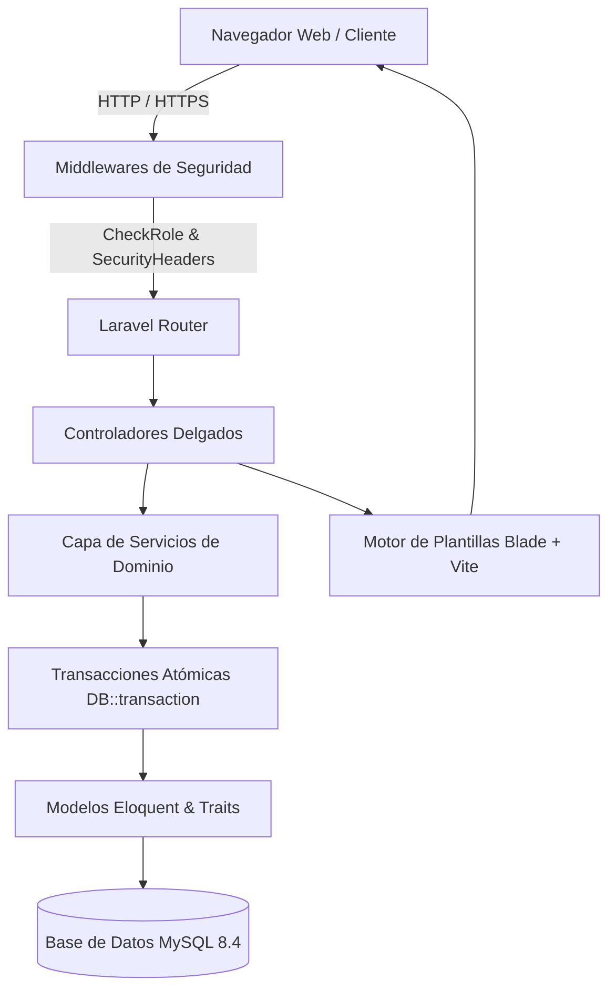
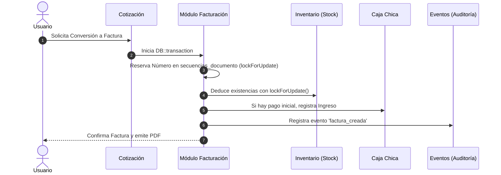

# 🏛️ Arquitectura del Sistema y Modelo de Datos — Tecni-Systemas

Este documento describe la arquitectura técnica, las decisiones de diseño y el modelo relacional del sistema **Tecni-Systemas**.

---

## 1. Arquitectura General del Software

El sistema está desarrollado sobre **Laravel 13** bajo el patrón Modelo-Vista-Controlador (MVC), complementado con una capa de servicios de dominio para transacciones financieras complejas.



### 1.1 Capas Principales
1. **Middlewares:**
   - [CheckRole](file:///c:/ServBay/www/tecni-systemas/app/Http/Middleware/CheckRole.php): Valida la identidad del usuario, estado de actividad (`active = 1`) y pertenencia a roles autorizados. Responde con 403 JSON en APIs y 302 hacia el Dashboard en solicitudes de navegador.
   - [SecurityHeaders](file:///c:/ServBay/www/tecni-systemas/app/Http/Middleware/SecurityHeaders.php): Inyecta cabeceras `X-Content-Type-Options: nosniff`, `X-Frame-Options: SAMEORIGIN`, `Referrer-Policy: strict-origin-when-cross-origin` y Content-Security-Policy (CSP).
2. **Servicios de Dominio:**
   - [AnulacionService](file:///c:/ServBay/www/tecni-systemas/app/Services/AnulacionService.php): Gestiona la reversión consistente de stock a bodega y anulación de movimientos de caja vinculados, con verificación de contraseña administrativa.
   - [OrdenService](file:///c:/ServBay/www/tecni-systemas/app/Services/OrdenService.php): Orquesta la duplicación, conversión y numeración de órdenes.
   - **Mecanismos de Secuencia:** Control numérico atómico para evitar colisiones en facturas y cotizaciones.

---

## 2. Modelo de Datos y Mecanismos de Integridad

### 2.1 Numeración Atómica (`secuencias_documento`)
Para mitigar condiciones de carrera provocadas por el patrón vulnerable `MAX(id) + 1` en entornos multiusuario concurrentes, se utiliza la tabla `secuencias_documento`:

```sql
CREATE TABLE secuencias_documento (
  prefijo VARCHAR(10) NOT NULL PRIMARY KEY,
  valor   INT UNSIGNED NOT NULL DEFAULT 0
) ENGINE=InnoDB;
```

**Mecanismo de incremento:**
```php
DB::transaction(function () use ($prefijo) {
    $secuencia = DB::table('secuencias_documento')
        ->where('prefijo', $prefijo)
        ->lockForUpdate()
        ->first();
    
    $nuevoValor = $secuencia->valor + 1;
    DB::table('secuencias_documento')
        ->where('prefijo', $prefijo)
        ->update(['valor' => $nuevoValor]);
        
    return sprintf('%s%06d', $prefijo, $nuevoValor);
});
```

---

### 2.2 Índices y Optimización de Consultas
Para garantizar alta velocidad de respuesta y prevenir table scans (escaneo completo de tablas):

| Tabla | Índice | Columnas | Objetivo |
|---|---|---|---|
| `eventos` | `idx_eventos_created_at` | `(created_at)` | Filtros rápidos por rango de fechas de auditoría. |
| `eventos` | `idx_eventos_modelo_created` | `(modelo_tipo, modelo_id, created_at)` | Consulta de historial de cambios por entidad específica. |
| `cotizaciones` | `idx_cotizaciones_fecha_estado` | `(fecha, estado)` | Informes y listados filtrados por periodo y estado. |
| `facturas` | `idx_facturas_estado_saldo` | `(estado, saldo_pendiente)` | Cálculo instantáneo de cuentas por cobrar. |
| `mantenimiento_stock` | `uq_mantenimiento_stock` | `(mantenimiento_id, stock_id)` | Previene repuestos duplicados dentro de la misma orden. |
| `electronica_stock` | `uq_electronica_stock` | `(electronica_id, stock_id)` | Previene repuestos duplicados en reparaciones electrónicas. |
| `factura_items` | `uq_factura_item_stock` | `(factura_id, stock_id)` | Integridad de renglones en facturación. |
| `cotizacion_items` | `uq_cotizacion_item` | `(cotizacion_id, item_id, tipo)` | Unicidad de items en cotizaciones. |

---

## 3. Flujo Transaccional Financiero



### 3.1 Garantías Transaccionales
- **Atomicidad Total:** Si durante la emisión de una factura el stock resulta insuficiente o la conexión a caja falla, toda la transacción se revierte (`ROLLBACK`), asegurando que jamás existan facturas sin stock ni salidas de inventario sin comprobante.
- **Bloqueos Pesimistas:** Los métodos de deducción y reversión de existencias emplean `lockForUpdate()`, impidiendo que dos solicitudes simultáneas vendan el mismo saldo de inventario.
